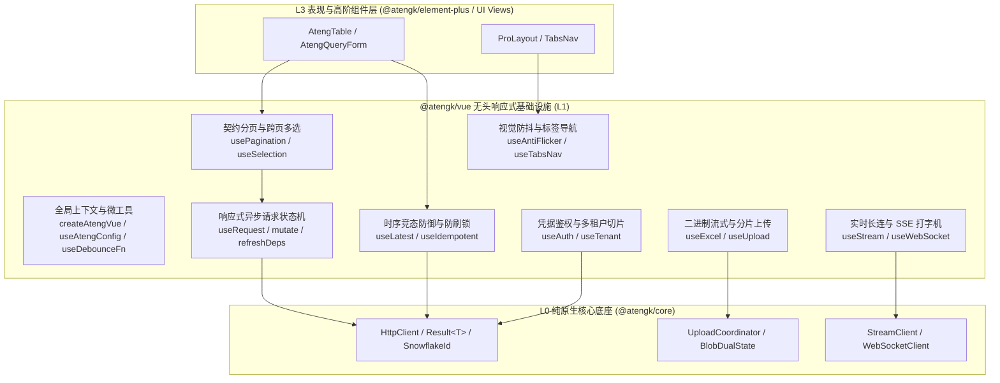

# @atengk/vue 响应式通用 Composables

> 面向现代 Web 应用与企业级系统的 Vue 3.5 工业级无头通用 Composables/Hooks 基础设施，处于系统四层拓扑的 **L1 无头响应式层**。遵循“纯响应式状态机驱动、严格单向数据流、零具体 UI 依赖、确定性生命周期清理”设计，全面继承 L0 底座的强类型契约与网络韧性。

---

## 0. 特性与公共 API 全景速查矩阵

| 特性分类       | 特性名称         | 核心门面 / 方法 / Hook                      | 关键参数 / 返回类型                           | 核心行为说明                                                                                                     | 锚定验证源头 (*Test / Sample)                                                                                                               |
| :------------- | :--------------- | :------------------------------------------ | :-------------------------------------------- | :--------------------------------------------------------------------------------------------------------------- | :------------------------------------------------------------------------------------------------------------------------------------------ |
| **基础导出**   | 基线版本标识     | `VERSION`                                   | `string`                                      | 导出当前模块编译版本基线                                                                                         | [index.test.ts](./test/index.test.ts)                                                                                                       |
| **全局上下文** | 插件安装器       | `createAtengVue(options?)`                  | `AtengVueOptions -> Plugin`                   | 向 Vue 应用实例全局注入默认配置上下文（默认分页大小、HTTP 实例等）                                               | [context.test.ts](./test/context.test.ts) / [ConfigDemo.vue](../../apps/sample-vue/src/components/ConfigDemo.vue)                           |
| **全局上下文** | 局部配置覆盖     | `provideAtengConfig(options)`               | `AtengVueOptions -> void`                     | 在组件子树层级局部覆盖上下文配置（Provider 依赖注入）                                                            | [context.test.ts](./test/context.test.ts) / [ConfigDemo.vue](../../apps/sample-vue/src/components/ConfigDemo.vue)                           |
| **全局上下文** | 配置解析 Hook    | `useAtengConfig()`                          | `() -> AtengVueContext`                       | 响应式获取当前生效的配置上下文，自动回退安全默认值与全局单例                                                     | [context.test.ts](./test/context.test.ts) / [ConfigDemo.vue](../../apps/sample-vue/src/components/ConfigDemo.vue)                           |
| **生命周期**   | 安全作用域销毁   | `tryOnScopeDispose(fn)`                     | `(() -> void) -> boolean`                     | 在活跃 effectScope 内安全挂载注销清理钩子，非作用域环境安全降级                                                  | [utils.test.ts](./test/utils.test.ts) / [UtilsDemo.vue](../../apps/sample-vue/src/components/UtilsDemo.vue)                                 |
| **受管微工具** | 原生防抖包装     | `useDebounceFn(fn, wait)`                   | `(fn, number) -> DebouncedFn`                 | 具备 cancel 与 flush 能力的原生防抖函数，在作用域注销时确定性清理                                                | [utils.test.ts](./test/utils.test.ts) / [UtilsDemo.vue](../../apps/sample-vue/src/components/UtilsDemo.vue)                                 |
| **受管微工具** | 原生节流包装     | `useThrottleFn(fn, interval)`               | `(fn, number) -> ThrottledFn`                 | 具备 cancel 能力的原生节流函数，在作用域注销时确定性回收定时器                                                   | [utils.test.ts](./test/utils.test.ts) / [UtilsDemo.vue](../../apps/sample-vue/src/components/UtilsDemo.vue)                                 |
| **受管微工具** | 全局事件监听     | `useEventListener(target, event, listener)` | `(Target, Event, Listener) -> void`           | 宿主安全事件监听绑定，组件或作用域销毁时 100% 自动解绑                                                           | [utils.test.ts](./test/utils.test.ts) / [UtilsDemo.vue](../../apps/sample-vue/src/components/UtilsDemo.vue)                                 |
| **异步请求**   | 请求状态机       | `useRequest(service, options?)`             | `(Service, Options) -> UseRequestResult`      | 提供 loading/data/error 只读状态机、防抖/节流/轮询、响应式依赖自动刷新 (`refreshDeps`) 与本地乐观更新 (`mutate`) | [useRequest.test.ts](./test/useRequest.test.ts) / [RequestDemo.vue](../../apps/sample-vue/src/components/RequestDemo.vue)                   |
| **契约分页**   | 分页调度状态机   | `usePagination(service, options?)`          | `(Service, Options) -> UsePaginationResult`   | 双向绑定 PageQuery/PageResult，五维原子动作（翻页/改条数/搜索/排序/重置）、依赖刷新与空数组保底防御              | [usePagination.test.ts](./test/usePagination.test.ts) / [PaginationDemo.vue](../../apps/sample-vue/src/components/PaginationDemo.vue)       |
| **跨页多选**   | 多选状态机       | `useSelection(options?)`                    | `(Options) -> UseSelectionResult<T>`          | 响应式跨页多选状态机，支持 `selectedKeys`/`selectedRows`/`selectedCount`，雪花 Long ID 大数字符串安全归一化      | [useSelection.test.ts](./test/useSelection.test.ts) / [SelectionDemo.vue](../../apps/sample-vue/src/components/SelectionDemo.vue)           |
| **时序竞态**   | 异步竞态双重防御 | `useLatest(asyncFn, options?)`              | `(AsyncFn, Options) -> UseLatestResult`       | “物理中断 (`AbortController`) + 逻辑过期丢弃”双重协同防御，彻底根绝高频操作时序倒挂脏写                          | [useLatest.test.ts](./test/useLatest.test.ts) / [LatestDemo.vue](../../apps/sample-vue/src/components/LatestDemo.vue)                       |
| **防刷防重**   | 提交幂等互斥锁   | `useIdempotent(actionFn, options?)`         | `(Action, Options) -> UseIdempotentResult`    | 按钮快速连打拦截、执行中互斥加锁与超时自动防死锁解除                                                             | [useIdempotent.test.ts](./test/useIdempotent.test.ts) / [IdempotentDemo.vue](../../apps/sample-vue/src/components/IdempotentDemo.vue)       |
| **鉴权状态**   | 响应式鉴权门面   | `useAuth(options?)`                         | `(Options) -> UseAuthResult`                  | 登录态双轨 Token 存取、401 自动清理广播与细粒度权限/角色通配匹配                                                 | [useAuthAndTenant.test.ts](./test/useAuthAndTenant.test.ts) / [AuthTenantDemo.vue](../../apps/sample-vue/src/components/AuthTenantDemo.vue) |
| **多租户隔离** | 响应式租户切片   | `useTenant(options?)`                       | `(Options) -> UseTenantResult`                | 动态多租户切片读取与切换，全应用响应式联动与请求头注入                                                           | [useAuthAndTenant.test.ts](./test/useAuthAndTenant.test.ts) / [AuthTenantDemo.vue](../../apps/sample-vue/src/components/AuthTenantDemo.vue) |
| **Excel 驱动** | 流式导出批注回写 | `useExcel(options?)`                        | `(Options) -> UseExcelResult`                 | 结合 Fesod 协议，流式导出、RFC 5987 文件名解析、Blob-JSON 双态拦截与内存确定性回收                               | [useExcel.test.ts](./test/useExcel.test.ts) / [ExcelDemo.vue](../../apps/sample-vue/src/components/ExcelDemo.vue)                           |
| **文件上传**   | 大文件分片并发   | `useUpload(options)`                        | `(Options) -> UseUploadResult`                | 纯原生切片计算、受控并发调度 (默认 3)、单调递增加权进度、断点续传与作用域注销自动取消                            | [useUpload.test.ts](./test/useUpload.test.ts) / [UploadDemo.vue](../../apps/sample-vue/src/components/UploadDemo.vue)                       |
| **流式打字机** | SSE 大模型流式   | `useStream(url, options?)`                  | `(Url, Options) -> UseStreamResult`           | 增量累积打字机流式文本、W3C SSE 增量解析、自动断连与作用域确定性注销                                             | [useStream.test.ts](./test/useStream.test.ts) / [StreamDemo.vue](../../apps/sample-vue/src/components/StreamDemo.vue)                       |
| **全双工长连** | WebSocket 状态机 | `useWebSocket(url, options?)`               | `(Url, Options) -> UseWebSocketResult`        | 四态状态机、双向心跳保活、假死超时判定、指数退避重连与受控离线发送缓冲队列                                       | [useWebSocket.test.ts](./test/useWebSocket.test.ts) / [WebSocketDemo.vue](../../apps/sample-vue/src/components/WebSocketDemo.vue)           |
| **加载防抖**   | 防闪烁时序状态机 | `useAntiFlicker(source, options?)`          | `(Source, Options) -> Readonly<Ref<boolean>>` | 150ms 静默延迟保护（极速 0ms 视觉打扰）+ 300ms 最小展示期（平滑淡出，彻底根绝 1 帧闪现“鬼影”）                   | [useAntiFlicker.test.ts](./test/useAntiFlicker.test.ts) / [AntiFlickerDemo.vue](../../apps/sample-vue/src/components/AntiFlickerDemo.vue)   |
| **框架导航**   | 多标签导航状态机 | `useTabsNav(options?)`                      | `(Options) -> UseTabsNavReturn`               | 多标签页纯算法无头响应式状态机，负责标签增删查改、FIFO 超限淘汰、Affix 保护、KeepAlive 缓存名单计算与刷新调度    | [useTabsNav.test.ts](./test/useTabsNav.test.ts) / [TabsNavDemo.vue](../../apps/sample-vue/src/components/TabsNavDemo.vue)                   |

---

## 1. 模块定位与 pnpm 坐标

- **npm 坐标**：`@atengk/vue`
- **拓扑层级**：L1 无头响应式层 (Headless Layer)
- **跨框架与解耦契约**：纯无头设计，**绝对严禁依赖任何具体 UI 库**（如 Element Plus、Ant Design Vue），不包含任何私有样式或 DOM 弹窗侵入，专注于 Vue 3.5 响应式状态机与生命周期治理。
- **安装依赖**：
  ```bash
  pnpm add @atengk/core @atengk/vue vue
  ```
- **依赖基线与 peerDependencies 契约**：
  - `vue`: `>=3.5.0`（利用原生响应式 Props 解构与 `toValue` 特性）
  - `@atengk/core`: `workspace:*`（底层强类型契约、网络引擎与工具底座）
  - `Node.js`: `>=20.18.0` / 现代主流浏览器

---

## 2. 核心架构与设计不变量



### 核心设计不变量 (Core Invariants)

1. **严格单向数据流与只读状态防线 (Readonly State & Unidirectional Flow)**：
   核心状态（`loading`、`data`、`error`、`pageNum`、`pageSize`、`total`、`list`、`selectedKeys` 等）统一通过 `readonly()` 导出为只读 Ref，外部严禁就地突变；修改只能通过门面动作（`run`、`changePage`、`select`、`toggle`）或显式乐观更新 `mutate((prev) => next)` 触发。
2. **空安全保底与防御性返回 (Null Safety & Defensive Fallback)**：
   分页 `usePagination` 与查询门面在网络异常或查询结果为空时，结果集列表统一保底返回空数组 `[]`，绝对严禁返回 `undefined` 或 `null`，彻底杜绝模板层 `v-for="item in data.list"` 发生空指针导致白屏崩溃。
3. **响应性解构防丢失规范 (MaybeRefOrGetter & toValue Invariant)**：
   所有导出的 Composables 入参必须声明为 `MaybeRefOrGetter<T>` 类型，内部统一使用 Vue 原生 `toValue(param)` 进行解包；组件层传入响应式变量时统一通过 Getter 箭头函数传入（如 `usePagination(..., () => pageSize)`），彻底消除响应性丢失陷阱。
4. **确定性生命周期与资源清理不变量 (Deterministic Scope Cleanup Invariant)**：
   凡在 Composables / Hooks 中注册的物理监听与瞬态资源（防抖节流定时器、DOM 事件绑定、WebSocket 长连接、SSE 流式通道、防闪烁状态定时器、未决请求取消信号 `AbortSignal`），统一在 `onScopeDispose` 钩子中 100% 确定性注销与解绑，严禁内存泄漏与离线回调悬挂。
5. **无头表现彻底解耦防线 (Headless & UI-Agnostic Invariant)**：
   属于纯无头中间件层，绝对严禁直接引用或物理调用 `ElMessage`、`ElNotification` 等具体 UI 弹窗组件；业务异常与失败反馈统一封装为响应式状态（如 `error`）或回调向外派发，具体交互提示完全交由上层表现层（`@atengk/element-plus` 或业务视图）接管。

---

## 3. 全局上下文与受管微工具套件 (Global Context & Utility Suite)

### 3.1 全局插件安装器与配置注入 (createAtengVue & useAtengConfig)

向 Vue 应用实例全局注入默认配置上下文（默认分页大小、自定义全局 HTTP 实例等），下游任意组件均可通过 `useAtengConfig()` 安全解析并具备健壮的默认回退。

#### 专属 TypeScript 契约片段

```ts
export interface AtengVueOptions {
  /** 全局默认分页每页容量 @default 20 */
  defaultPageSize?: number;
  /** 全局自定义 HTTP 客户端实例（缺省时自动使用 @atengk/core 全局单例） */
  httpClient?: HttpClient;
  /** 是否在挂载时自动连接全局流式客户端 @default false */
  autoConnectStream?: boolean;
  /** 是否在挂载时自动连接全局 WebSocket 客户端 @default false */
  autoConnectWebSocket?: boolean;
}

export function createAtengVue(options?: AtengVueOptions): Plugin;
export function useAtengConfig(): AtengVueContext;
```

#### 实战业务代码示例

```ts
// 1. main.ts 入口全局注册插件
import { createApp } from 'vue';
import { createAtengVue } from '@atengk/vue';
import App from './App.vue';

const app = createApp(App);
app.use(createAtengVue({ defaultPageSize: 20 }));
app.mount('#app');
```

```vue
<!-- 2. 任意组件解析配置 (ConfigDemo.vue) -->
<script setup lang="ts">
import { useAtengConfig } from '@atengk/vue';

// 读取当前生效的配置上下文
const config = useAtengConfig();
</script>

<template>
  <div class="config-card">
    <span>全局默认分页大小: {{ config.defaultPageSize }} 条/页</span>
    <span>HTTP 客户端状态: {{ config.httpClient ? '已注入' : '未就绪' }}</span>
  </div>
</template>
```

#### 核心机制与生产边界说明

- **双轨解耦回退**：组件未显式执行 `app.use(createAtengVue(...))` 时，`useAtengConfig()` 会自动平滑回退至内部安全默认值（`defaultPageSize: 20`，HTTP 回退至 `@atengk/core` 的 `http` 单例），绝不抛出 NPE。

---

### 3.2 局部上下文覆盖注入 (provideAtengConfig)

支持在局部路由视图或弹窗子树中覆盖配置，实现与全局配置的继承与局部特化。

#### 专属 TypeScript 契约片段

```ts
export function provideAtengConfig(options: AtengVueOptions): void;
```

#### 实战业务代码示例

```vue
<script setup lang="ts">
import { provideAtengConfig } from '@atengk/vue';

// 局部覆盖当前管理后台模块的默认分页大小为 50 条/页
provideAtengConfig({
  defaultPageSize: 50,
});
</script>

<template>
  <div class="sub-tree-container">
    <router-view />
  </div>
</template>
```

#### 核心机制与生产边界说明

- **Vue 依赖注入机制**：基于 `provide/inject` 原生树状继承机制，仅对当前组件及其后代组件生效，兄弟节点与上层树不受污染。

---

### 3.3 原生受管防抖与节流包装 (useDebounceFn & useThrottleFn)

纯原生闭环实现的受管防抖与节流微工具，具备 `cancel` 与 `flush` 操作门面，并在组件作用域注销时自动回收定时器。

#### 专属 TypeScript 契约片段

```ts
export interface DebouncedFn<T extends (...args: any[]) => any> {
  (...args: Parameters<T>): void;
  /** 立即取消未决的防抖定时器 */
  cancel: () => void;
  /** 立即执行未决的防抖回调 */
  flush: () => void;
}

export function useDebounceFn<T extends (...args: any[]) => any>(
  fn: T,
  wait?: number,
): DebouncedFn<T>;
export function useThrottleFn<T extends (...args: any[]) => any>(
  fn: T,
  interval?: number,
): ThrottledFn<T>;
```

#### 实战业务代码示例 (UtilsDemo.vue)

```vue
<script setup lang="ts">
import { ref } from 'vue';
import { useDebounceFn, useThrottleFn } from '@atengk/vue';

const searchInput = ref('');
const resolvedKeyword = ref('');

// 1. 防抖处理联想搜索输入 (300ms)
const handleSearch = useDebounceFn((val: string) => {
  resolvedKeyword.value = val;
}, 300);

// 2. 节流处理高频物理点击 (1000ms 仅计一次)
const clickCount = ref(0);
const handleThrottledClick = useThrottleFn(() => {
  clickCount.value += 1;
}, 1000);
</script>

<template>
  <div>
    <input v-model="searchInput" @input="handleSearch(searchInput)" placeholder="输入搜索..." />
    <p>防抖决议结果: {{ resolvedKeyword }}</p>

    <button @click="handleThrottledClick">高频点击测试 (1秒内仅计1次)</button>
    <p>有效点击: {{ clickCount }}</p>
  </div>
</template>
```

#### 核心机制与生产边界说明

- **零外部依赖与确定性清理**：坚决不引入 `lodash` 或 `vueuse`，内部通过 `onScopeDispose` 自动调用 `cancel()` 清空活跃定时器，杜绝组件销毁后离线回调悬挂。

---

### 3.4 宿主安全事件监听与作用域确定性清理 (useEventListener & tryOnScopeDispose)

宿主环境安全的事件监听器绑定，兼容 Node/SSR 静态构建环境，在组件或 effectScope 销毁时 100% 自动解绑。

#### 专属 TypeScript 契约片段

```ts
export function tryOnScopeDispose(fn: () => void): boolean;
export function useEventListener<K extends keyof WindowEventMap>(
  target: MaybeRefOrGetter<Window | Document | HTMLElement | null | undefined>,
  event: K,
  listener: (this: Window, ev: WindowEventMap[K]) => any,
  options?: boolean | AddEventListenerOptions,
): () => void;
```

#### 实战业务代码示例

```vue
<script setup lang="ts">
import { ref } from 'vue';
import { useEventListener } from '@atengk/vue';

const windowClickCount = ref(0);

// 监听全局 Window 点击，组件卸载时自动确定性解绑
useEventListener(window, 'click', () => {
  windowClickCount.value += 1;
});
</script>

<template>
  <p>全局 Window 点击累计: {{ windowClickCount }} 次</p>
</template>
```

#### 核心机制与生产边界说明

- **SSR 宿主环境防卫**：自动探测 `target` 是否存在；在 SSR 或 Node 命令行环境下静默跳过物理挂载，防止报错崩溃。

---

## 4. 响应式异步请求状态机套件 (Async Request State Machine)

### 4.1 只读请求状态机与自动/手动调度 (useRequest)

封装异步请求的完整生命周期状态机，将 `loading`、`data`、`error` 封装为受控只读状态，提供 `refresh`、`run` 以及抗竞态调度。

#### 专属 TypeScript 契约片段

```ts
export interface UseRequestOptions<TData, TParams extends unknown[]> {
  /** 是否在初始化时自动发起请求 @default true */
  manual?: boolean;
  /** 默认初始入参 */
  defaultParams?: TParams;
  /** 响应式依赖自动刷新源 */
  refreshDeps?: WatchSource<unknown> | WatchSource<unknown>[];
  /** 轮询间隔（毫秒） */
  pollingInterval?: number;
  /** 请求成功回调 */
  onSuccess?: (data: TData, params: TParams) => void;
  /** 请求异常回调 */
  onError?: (error: BusinessException, params: TParams) => void;
}

export interface UseRequestResult<TData, TParams extends unknown[]> {
  loading: Readonly<Ref<boolean>>;
  data: Readonly<Ref<TData | undefined>>;
  error: Readonly<Ref<BusinessException | null>>;
  run: (...params: TParams) => Promise<TData>;
  refresh: () => Promise<TData>;
  mutate: (mutator: TData | ((prev: TData | undefined) => TData | undefined)) => void;
  cancel: () => void;
}
```

#### 实战业务代码示例 (RequestDemo.vue)

```vue
<script setup lang="ts">
import { ref } from 'vue';
import { useRequest } from '@atengk/vue';

interface UserProfile {
  id: number;
  name: string;
  role: string;
}

// 模拟异步数据请求服务
const fetchUser = async (id: number): Promise<UserProfile> => {
  const res = await fetch(`/api/users/${id}`);
  return res.json();
};

const currentUserId = ref(1);
const userRequest = useRequest(fetchUser, {
  defaultParams: [1],
});

// 手动切换入参请求
const onSwitchUser = (id: number) => {
  currentUserId.value = id;
  userRequest.run(id);
};
</script>

<template>
  <div class="user-profile-panel">
    <div class="btn-group">
      <button :disabled="userRequest.loading.value" @click="userRequest.refresh()">
        {{ userRequest.loading.value ? '刷新中...' : '刷新当前用户' }}
      </button>
      <button
        :disabled="userRequest.loading.value"
        @click="onSwitchUser(currentUserId === 1 ? 2 : 1)"
      >
        切换用户 (ID: {{ currentUserId === 1 ? 2 : 1 }})
      </button>
    </div>

    <div v-if="userRequest.loading.value">加载中...</div>
    <pre>{{ JSON.stringify(userRequest.data.value, null, 2) || '(暂无数据)' }}</pre>
  </div>
</template>
```

#### 核心机制与生产边界说明

- **严格只读状态防线**：`loading`、`data`、`error` 均经过 `readonly()` 包装，调用方无法直接就地执行 `loading.value = false`，保证状态转移路径 100% 确定可追溯。

---

### 4.2 本地乐观更新与响应式依赖自动刷新 (mutate & refreshDeps)

在无需重新发起 HTTP 请求的场景下，通过 `mutate` 实现毫秒级本地乐观更新；配置 `refreshDeps` 监听外部响应式变量并在变化时自动重发请求。

#### 实战业务代码示例

```ts
// 1. 本地乐观更新：直接变更视图状态
const onOptimisticMutate = () => {
  userRequest.mutate(prev => (prev ? { ...prev, name: `${prev.name} [本地乐观修改]` } : undefined));
};

// 2. 响应式依赖自动刷新
const activeDeptId = ref(101);
const deptRequest = useRequest(() => fetchUsersByDept(activeDeptId.value), {
  refreshDeps: activeDeptId, // 当部门 ID 变化时，自动重新请求
});
```

#### 核心机制与生产边界说明

- **不可变单向流**：`mutate` 接受当前数据的副本并返回新实体，内部通过不可变对象替换触发 Vue 响应式更新，杜绝深层属性直接突变导致的脏状态残留。

---

## 5. 契约分页与跨页多选状态机套件 (Contract Pagination & Selection Suite)

### 5.1 双向契约分页状态机与五维原子动作 (usePagination)

基于 `useRequest` 深度特化组合，零样板双向绑定 `PageQuery` 入参与 `PageResult<T>` 响应，结果集硬性保底空数组 `[]`，内置五维原子动作调度。

#### 专属 TypeScript 契约片段

```ts
export interface UsePaginationOptions<TItem, TQuery extends PageQuery = PageQuery> {
  defaultPageSize?: number;
  defaultCurrent?: number;
  defaultParams?: Partial<TQuery>;
  defaultSortField?: string;
  defaultSortAsc?: boolean;
  refreshDeps?: WatchSource<unknown> | WatchSource<unknown>[];
}

export interface UsePaginationResult<TItem, TQuery extends PageQuery = PageQuery> {
  pageNum: Readonly<Ref<number>>;
  pageSize: Readonly<Ref<number>>;
  total: Readonly<Ref<number>>;
  list: Readonly<Ref<TItem[]>>; // 空安全硬性保底空数组 []
  loading: Readonly<Ref<boolean>>;
  error: Readonly<Ref<BusinessException | null>>;
  changePage: (page: number) => Promise<PageResult<TItem>>;
  changePageSize: (size: number) => Promise<PageResult<TItem>>;
  search: (extraParams?: Partial<TQuery>) => Promise<PageResult<TItem>>;
  changeSort: (field?: string, asc?: boolean) => Promise<PageResult<TItem>>;
  reset: () => Promise<PageResult<TItem>>;
}
```

#### 实战业务代码示例 (PaginationDemo.vue)

```vue
<script setup lang="ts">
import { usePagination } from '@atengk/vue';
import type { PageQuery, PageResult } from '@atengk/core';

interface ProductItem {
  id: string; // 64位雪花 Long ID
  name: string;
  price: number;
}

// 模拟分页服务
const queryProducts = async (params: PageQuery): Promise<PageResult<ProductItem>> => {
  const res = await fetch(`/api/products?pageNum=${params.pageNum}&pageSize=${params.pageSize}`);
  return res.json();
};

const { pageNum, pageSize, total, list, loading, changePage, changePageSize, search, reset } =
  usePagination(queryProducts, {
    defaultPageSize: 10,
    defaultSortField: 'createTime',
    defaultSortAsc: false,
  });
</script>

<template>
  <div class="table-container">
    <div class="search-bar">
      <button @click="search({ sortField: 'price', sortAsc: true })">按价格升序搜索</button>
      <button @click="reset">重置初始条件</button>
    </div>

    <table>
      <thead>
        <tr>
          <th>ID</th>
          <th>商品名称</th>
          <th>单价</th>
        </tr>
      </thead>
      <tbody>
        <!-- 空安全保底：list 100% 为数组，绝不触发 NPE -->
        <tr v-for="item in list" :key="item.id">
          <td>{{ item.id }}</td>
          <td>{{ item.name }}</td>
          <td>¥{{ item.price }}</td>
        </tr>
      </tbody>
    </table>

    <div class="pagination-footer">
      <button :disabled="pageNum <= 1" @click="changePage(pageNum - 1)">上一页</button>
      <span>第 {{ pageNum }} 页 / 共 {{ total }} 条</span>
      <button @click="changePage(pageNum + 1)">下一页</button>
      <button @click="changePageSize(20)">改为 20 条/页</button>
    </div>
  </div>
</template>
```

#### 核心机制与生产边界说明

- **五维原子动作重置规则**：`search()`、`changePageSize()`、`changeSort()` 以及 `reset()` 均会自动将当前页码归 1 发起请求；`changePage()` 则精确定位目标页码。
- **空安全绝对保底**：底层拦截未决返回，若服务端返回 `null` 或无 `list` 节点，内部一律防御保底为 `[]`，杜绝前端白屏。

---

### 5.2 跨页多选记忆与雪花 ID 键值映射 (useSelection)

负责表格或卡片列表跨页勾选集合记忆、全选/反选、排他选中与 64 位雪花 Long ID 键值字符串安全归一化。

#### 专属 TypeScript 契约片段

```ts
export interface UseSelectionOptions<T> {
  /** 指定行主键属性名或主键提取函数（默认 'id'） */
  rowKey?: keyof T | ((row: T) => string | number | bigint);
  /** 初始已选数据项 */
  initialSelected?: T[];
}

export interface UseSelectionResult<T> {
  selectedKeys: ComputedRef<string[]>;
  selectedRows: ComputedRef<T[]>;
  selectedCount: ComputedRef<number>;
  isSelected: (row: T) => boolean;
  isKeySelected: (key: string | number | bigint) => boolean;
  select: (rows: T | T[]) => void;
  deselect: (rows: T | T[]) => void;
  toggle: (row: T) => void;
  clear: () => void;
  selectAll: (rows: T[]) => void;
  syncWithData: (currentData: T[]) => void;
}
```

#### 实战业务代码示例 (SelectionDemo.vue)

```vue
<script setup lang="ts">
import { useSelection } from '@atengk/vue';

interface ProductSkuItem {
  id: string; // 雪花 Long ID (保证为 string，防精度截断)
  skuCode: string;
  name: string;
}

const { selectedKeys, selectedRows, selectedCount, isSelected, toggle, selectAll, clear } =
  useSelection<ProductSkuItem>({
    rowKey: 'id',
  });
</script>

<template>
  <div>
    <button :disabled="selectedCount === 0" @click="clear">
      清空已选项 (已选 {{ selectedCount }} 项)
    </button>
    <div class="selected-tags">
      <span v-for="k in selectedKeys" :key="k" class="tag">{{ k }}</span>
    </div>
  </div>
</template>
```

#### 核心机制与生产边界说明

- **雪花 Long ID 大数防截断**：内部存储的 Key 统一通过 `String(key)` 进行字符串归一化映射，无论上层传入原生大数还是字符串，均不会发生 $2^{53}-1$ 精度失真。
- **不可变更新性能**：内部采用 `shallowRef<Map<string, T>>` 托管，单次变更生成新 Map 替换，在大数据量跨页勾选中依然具备极致响应性能。

---

## 6. 异步时序抗竞态与防刷幂等锁套件 (Anti-Race & Idempotent Lock Suite)

### 6.1 异步时序竞态“物理中断 + 逻辑过期”双重防御 (useLatest)

解决搜索框快速输入联想、快速切换 Tab 档案卡片等高频异步场景下的时序倒挂问题，确保仅最新一次请求生效并安全丢弃未决前序请求。

#### 专属 TypeScript 契约片段

```ts
export interface UseLatestOptions<TResult> {
  onSuccess?: (data: TResult) => void;
  onError?: (error: unknown) => void;
}

export interface UseLatestResult<TArgs extends unknown[], TResult> {
  loading: Readonly<Ref<boolean>>;
  data: Readonly<Ref<TResult | undefined>>;
  error: Readonly<Ref<unknown>>;
  run: (...args: TArgs) => Promise<TResult | undefined>;
  cancel: () => void;
}
```

#### 实战业务代码示例 (LatestDemo.vue)

```vue
<script setup lang="ts">
import { useLatest } from '@atengk/vue';

// 模拟异步搜索客户档案
const searchCustomer = async (signal: AbortSignal, keyword: string): Promise<string> => {
  const res = await fetch(`/api/customers/search?kw=${keyword}`, { signal });
  return res.text();
};

// 包装抗竞态状态机
const latestSearch = useLatest(searchCustomer);

// 高频输入触发搜索
const onInput = (keyword: string) => {
  latestSearch.run(keyword);
};
</script>

<template>
  <input
    @input="e => onInput((e.target as HTMLInputElement).value)"
    placeholder="快速输入搜索客户..."
  />
  <div v-if="latestSearch.loading.value">搜索匹配中...</div>
  <div>最新生效结果: {{ latestSearch.data.value }}</div>
</template>
```

#### 核心机制与生产边界说明

- **双重协同防线**：
  1. **物理中断**：若异步函数第一个入参接收 `AbortSignal`，`useLatest` 会自动创建 `AbortController` 并在新请求发起时物理切断前序在途 HTTP 连接，节省带宽；
  2. **逻辑过期**：通过内部自增序列号递增标记，即便前序请求底层不支持取消或物理返回，也会在回调时刻判定过期并确定性丢弃，彻底根除数据时序倒挂。

---

### 6.2 写操作防刷防重与超时互斥防死锁 (useIdempotent)

针对保存、提交、删除、审批等写操作请求，提供按钮连打拦截、执行中互斥加锁与超时自动防死锁解除。

#### 专属 TypeScript 契约片段

```ts
export interface UseIdempotentOptions {
  /** 互斥锁超时时间（毫秒），超时后自动释放防止死锁 @default 10000 */
  timeout?: number;
  /** 重复触发被拦截时的告警回调 */
  onDuplicate?: () => void;
}

export interface UseIdempotentResult<TArgs extends unknown[], TResult> {
  executing: Readonly<Ref<boolean>>;
  run: (...args: TArgs) => Promise<TResult | undefined>;
  unlock: () => void;
}
```

#### 实战业务代码示例 (IdempotentDemo.vue)

```vue
<script setup lang="ts">
import { useIdempotent } from '@atengk/vue';

const submitOrder = async (orderId: string) => {
  await fetch(`/api/orders/${orderId}/pay`, { method: 'POST' });
};

const { executing, run: handlePay } = useIdempotent(submitOrder, {
  timeout: 5000,
  onDuplicate: () => {
    alert('正在处理中，请勿重复点击！');
  },
});
</script>

<template>
  <button :disabled="executing" @click="handlePay('ORD-20261104-001')">
    {{ executing ? '支付处理中 (已加锁)...' : '确认支付订单' }}
  </button>
</template>
```

#### 核心机制与生产边界说明

- **超时自动防死锁**：若网络请求因异常永久挂起未返回，超时定时器到达预设时间后会自动释放互斥锁，确保界面按钮不会被永久冻结。
- **作用域安全**：组件销毁时内部超时定时器通过 `onScopeDispose` 确定性清空，无内存泄露风险。

---

## 7. 响应式鉴权凭据与多租户切片套件 (Auth & Multi-Tenant Slice Suite)

### 7.1 响应式鉴权凭据与细粒度权限校验 (useAuth)

响应式对接 L0 鉴权管理器，提供当前登录凭据提取、退出登录广播与细粒度权限/角色通配校验。

#### 专属 TypeScript 契约片段

```ts
export interface UseAuthOptions {
  authManager?: AuthManager;
}

export interface UseAuthResult {
  token: Readonly<Ref<string | null>>;
  isAuthenticated: ComputedRef<boolean>;
  setToken: (token: string) => void;
  clearToken: () => void;
  hasPermission: (permission: string, userPermissions: string[]) => boolean;
  hasRole: (role: string, userRoles: string[]) => boolean;
}
```

#### 实战业务代码示例 (AuthTenantDemo.vue)

```vue
<script setup lang="ts">
import { useAuth } from '@atengk/vue';

const { token, isAuthenticated, setToken, clearToken, hasPermission } = useAuth();

// 用户拥有的权限列表
const permissions = ['sys:user:list', 'sys:user:create', 'sys:user:export'];

const onLogin = () => setToken('mock-jwt-token-production-123456');
const onLogout = () => clearToken();
</script>

<template>
  <div>
    <button v-if="!isAuthenticated" @click="onLogin">模拟登录注入 Token</button>
    <button v-else @click="onLogout">退出登录</button>

    <div v-if="hasPermission('sys:user:export', permissions)">
      <button>具备导出权限 (sys:user:export)</button>
    </div>
  </div>
</template>
```

#### 核心机制与生产边界说明

- **双轨请求头同步**：通过 `setToken` 设置凭据后，后续由 `@atengk/core` 发起的 HTTP 请求将自动注入 `token` 与 `Authorization: Bearer` 双轨请求头。

---

### 7.2 动态多租户上下文隔离与状态切片 (useTenant)

响应式管理当前微服务多租户标识，并在切换租户时实现全视图响应式刷新与请求头注入。

#### 专属 TypeScript 契约片段

```ts
export interface UseTenantOptions {
  tenantManager?: TenantManager;
}

export interface UseTenantResult {
  tenantId: Readonly<Ref<string | null>>;
  hasTenant: ComputedRef<boolean>;
  setTenantId: (tenantId: string) => void;
  clearTenantId: () => void;
}
```

#### 实战业务代码示例

```vue
<script setup lang="ts">
import { useTenant } from '@atengk/vue';

const { tenantId, setTenantId } = useTenant();
</script>

<template>
  <select :value="tenantId" @change="e => setTenantId((e.target as HTMLSelectElement).value)">
    <option value="tenant_dev">研发租户 (tenant_dev)</option>
    <option value="tenant_prod">生产主租户 (tenant_prod)</option>
  </select>
</template>
```

#### 核心机制与生产边界说明

- **请求头自动挂载**：更新 `tenantId` 后，核心网络客户端会自动将 `X-Tenant-Id` 请求头透传至每个下游网关请求。

---

## 8. 二进制安全传输与流式导出套件 (Binary Transport & Excel Suite)

### 8.1 基于 Fesod 协议的流式 Excel 导出与 Blob-JSON 双态拦截 (useExcel)

结合 Apache Fesod 协议，调度后端大报表流式 Excel 下载，规范解析 RFC 5987 文件名，并实施 Blob-JSON 双态异常识别。

#### 专属 TypeScript 契约片段

```ts
export interface UseExcelOptions {
  httpClient?: HttpClient;
  onSuccess?: (filename: string) => void;
  onError?: (error: BusinessException) => void;
}

export interface UseExcelResult {
  exporting: Readonly<Ref<boolean>>;
  exportExcel: (url: string, params?: unknown, filename?: string) => Promise<boolean>;
}
```

#### 实战业务代码示例 (ExcelDemo.vue)

```vue
<script setup lang="ts">
import { useExcel } from '@atengk/vue';

const { exporting, exportExcel } = useExcel({
  onSuccess: filename => alert(`导出成功: ${filename}`),
  onError: err => alert(`导出失败: ${err.message}`),
});

const onExport = () => {
  exportExcel('/api/finance/monthly-ledger/export', { month: '2026-10' });
};
</script>

<template>
  <button :disabled="exporting" @click="onExport">
    {{ exporting ? '流式导出生成中...' : '导出月度财务报表 (Excel)' }}
  </button>
</template>
```

#### 核心机制与生产边界说明

- **Blob-JSON 双态识别**：后端报表导出如果因为权限不足或参数错误返回 500 JSON，拦截器自动识别并反序列化为 `BusinessException` 抛出，杜绝下载假文件。
- **内存确定性回收**：浏览器端下载完成后自动执行 `URL.revokeObjectURL` 释放 Blob 内存。

---

### 8.2 大文件纯原生切片与受控并发上传协调器 (useUpload)

基于原生 Blob.slice 字节切分大文件，调度受控并发上传，提供加权进度、单片重试与生命周期级联取消。

#### 专属 TypeScript 契约片段

```ts
export interface UseUploadOptions {
  uploadUrl: string;
  chunkSize?: number; // 分片大小（字节）默认 5MB
  concurrency?: number; // 最大并发连接数 默认 3
  onSuccess?: (response: unknown) => void;
  onError?: (error: unknown) => void;
}

export interface UseUploadResult {
  uploading: Readonly<Ref<boolean>>;
  progress: Readonly<Ref<number>>; // 0~100 单调递增
  upload: (file: File) => Promise<void>;
  pause: () => void;
  resume: () => Promise<void>;
  cancel: () => void;
}
```

#### 实战业务代码示例 (UploadDemo.vue)

```vue
<script setup lang="ts">
import { useUpload } from '@atengk/vue';

const { uploading, progress, upload, pause, cancel } = useUpload({
  uploadUrl: '/api/files/chunk-upload',
  chunkSize: 5 * 1024 * 1024, // 5MB 分片
  concurrency: 3, // 受控 3 并发
});

const onFileChange = (e: Event) => {
  const file = (e.target as HTMLInputElement).files?.[0];
  if (file) {
    upload(file);
  }
};
</script>

<template>
  <div>
    <input type="file" @change="onFileChange" :disabled="uploading" />
    <button :disabled="!uploading" @click="pause">暂停</button>
    <button :disabled="!uploading" @click="cancel">取消</button>
    <div class="progress-bar">
      <div class="progress-inner" :style="{ width: `${progress}%` }">{{ progress }}%</div>
    </div>
  </div>
</template>
```

#### 核心机制与生产边界说明

- **级联中断不变量**：调用 `cancel()` 或组件销毁时，所有在途的分片 HTTP 连接均会被传入的 `AbortSignal` 立即物理切断，绝不空耗客户端网络与带宽。

---

## 9. 实时长连通信与服务端流式套件 (Real-Time Stream & WebSocket Suite)

### 9.1 SSE 服务端发送事件与打字机流式响应 (useStream)

封装 Web 原生 ReadableStream 与 W3C SSE 协议，增量累积流式文本，原生支持 AI 大模型智能助手流式问答打字机效果。

#### 专属 TypeScript 契约片段

```ts
export interface UseStreamOptions {
  method?: 'GET' | 'POST';
  body?: unknown;
  headers?: Record<string, string>;
  onMessage?: (event: SseEvent) => void;
  onError?: (error: unknown) => void;
  onFinish?: () => void;
}

export interface UseStreamResult {
  streaming: Readonly<Ref<boolean>>;
  text: Readonly<Ref<string>>;
  start: () => Promise<void>;
  stop: () => void;
}
```

#### 实战业务代码示例 (StreamDemo.vue)

```vue
<script setup lang="ts">
import { useStream } from '@atengk/vue';

const { streaming, text, start, stop } = useStream('/api/ai/diagnose/stream', {
  method: 'POST',
  body: { prompt: '分析当前微服务集群实时性能瓶颈' },
});
</script>

<template>
  <div>
    <button :disabled="streaming" @click="start">开始 AI 诊断问答</button>
    <button :disabled="!streaming" @click="stop">中断生成</button>

    <div class="typewriter-output">
      <p>{{ text }}</p>
      <span v-if="streaming" class="cursor">|</span>
    </div>
  </div>
</template>
```

#### 核心机制与生产边界说明

- **抗网络撕裂分包**：底层集成 L0 `SseParser` 状态机，能跨越网络分块正确处理多字节 UTF-8 字符（如中文 emoji），绝不发生乱码与格式撕裂。

---

### 9.2 全双工 WebSocket 长连接与双向心跳重连状态机 (useWebSocket)

基于纯原生 WebSocket API，提供四态状态机（Connecting, Open, Closing, Closed）、定时 Ping/Pong 心跳保活、假死超时判定、指数退避重连与离线缓冲队列。

#### 专属 TypeScript 契约片段

```ts
export interface UseWebSocketOptions {
  autoConnect?: boolean; // @default true
  heartbeat?: WebSocketHeartbeatOptions; // Ping/Pong 保活
  reconnect?: WebSocketReconnectOptions; // 指数退避断网重连
  protocols?: string | string[];
}

export interface UseWebSocketResult {
  status: Readonly<Ref<WebSocketStatus>>;
  latestMessage: Readonly<Ref<string | null>>;
  connect: () => void;
  disconnect: () => void;
  send: (data: string | ArrayBufferLike | Blob | ArrayBufferView) => boolean;
}
```

#### 实战业务代码示例 (WebSocketDemo.vue)

```vue
<script setup lang="ts">
import { useWebSocket } from '@atengk/vue';

const { status, latestMessage, connect, disconnect, send } = useWebSocket(
  'wss://api.example.com/ws',
  {
    autoConnect: true,
    heartbeat: {
      interval: 15000,
      timeout: 5000,
      pingMessage: 'ping',
      pongMessage: 'pong',
    },
    reconnect: {
      maxRetries: 10,
      baseDelay: 1000,
      maxDelay: 30000,
    },
  },
);
</script>

<template>
  <div>
    <span>连接状态: {{ status }}</span>
    <button @click="connect">连接</button>
    <button @click="disconnect">断开</button>
    <button @click="send('手动发送运维告警查询')">发送数据</button>
    <p>最新接收推送: {{ latestMessage }}</p>
  </div>
</template>
```

#### 核心机制与生产边界说明

- **假死超时主动断线**：若服务端因网络分区未按时回复 Pong，心跳状态机判定为死连接，主动关闭底层物理连接并触发指数退避重连。
- **离线缓冲队列**：在网络重连恢复期间发送的消息会自动进入 FIFO 离线队列，就绪后自动顺序 Flush。

---

## 10. 高阶视觉平滑与导航调度状态机 (Visual Smoothing & Navigation Suite)

### 10.1 150ms 静默延迟与 300ms 最小展示期防闪烁状态机 (useAntiFlicker)

高阶加载感知防抖时序状态机，为各类异步请求提供 150ms 静默延迟（极速响应 0ms 视觉打扰）与 300ms 最小展示期（优雅平滑淡出，彻底消除 1 帧闪现震颤）。

#### 专属 TypeScript 契约片段

```ts
export interface AntiFlickerOptions {
  /** 静默延迟保护窗口（毫秒） @default 150 */
  delay?: number;
  /** 突破延迟阈值后的最小展示时长（毫秒） @default 300 */
  minDuration?: number;
}

export function useAntiFlicker(
  source: MaybeRefOrGetter<boolean>,
  options?: AntiFlickerOptions,
): Readonly<Ref<boolean>>;
```

#### 实战业务代码示例 (AntiFlickerDemo.vue)

```vue
<script setup lang="ts">
import { ref } from 'vue';
import { useAntiFlicker } from '@atengk/vue';

// 原始业务 loading 状态
const rawLoading = ref(false);

// 包装防闪烁时序保护状态
const smoothLoading = useAntiFlicker(rawLoading, {
  delay: 150,
  minDuration: 300,
});
</script>

<template>
  <div class="panel">
    <!-- 极速接口（50ms）：smoothLoading 全程保持 false，用户零视觉打扰 -->
    <!-- 慢速接口（500ms）：突破 150ms 后激活展示，且保证平滑展示至少 300ms -->
    <div v-if="smoothLoading" class="loading-spinner">加载中...</div>
  </div>
</template>
```

#### 核心机制与生产边界说明

- **时序对撞处理**：若源状态在延迟窗口内迅速归零（例如 50ms 极速返回），定时器立即注销，指示器从未展示；若耗时超过 150ms 激活后又在 180ms 归零，定时器将自动补齐剩余 270ms 展示期后才优雅淡出，消除视觉跳跃。
- **作用域确定性清理**：在 `onScopeDispose` 中自动清空内部所有活跃定时器。

---

### 10.2 多标签页调度、FIFO 容量淘汰与 KeepAlive 缓存名单 (useTabsNav)

企业级多标签页纯算法无头响应式状态机，负责标签增删查改、固定防关 (Affix)、FIFO 超限自动淘汰、KeepAlive 缓存视图清单计算 (`cachedViews`) 与局部刷新调度。

#### 专属 TypeScript 契约片段

```ts
export interface TabItem {
  key: string;
  title: string;
  closable?: boolean;
  affix?: boolean; // 固钉保护（不可关闭，锁定在最前）
  componentName?: string; // 对应 Vue SFC 组件 name，供 KeepAlive 缓存使用
  meta?: Record<string, unknown>;
}

export interface UseTabsNavOptions {
  defaultTabs?: TabItem[];
  defaultActiveKey?: string;
  maxTabs?: number; // 最大打开标签数量，超限按 FIFO 淘汰最早未固定的非激活项
  persistKey?: string; // 本地会话持久化键名
  storageType?: 'session' | 'local';
  onRefresh?: (key: string) => Promise<void> | void;
  onClose?: (key: string, tab: TabItem) => void;
}

export interface UseTabsNavReturn {
  tabs: Ref<TabItem[]>;
  activeKey: Ref<string>;
  cachedViews: ComputedRef<string[]>; // 传递给 <KeepAlive :include="cachedViews">
  openTab: (tab: TabItem) => void;
  closeTab: (key: string) => void;
  closeOthers: (key?: string) => void;
  closeLeft: (key?: string) => void;
  closeRight: (key?: string) => void;
  closeAll: () => void;
  refreshTab: (key?: string) => Promise<void>;
  pinTab: (key: string, pinned?: boolean) => void;
}
```

#### 实战业务代码示例 (TabsNavDemo.vue)

```vue
<script setup lang="ts">
import { useTabsNav } from '@atengk/vue';

const { tabs, activeKey, cachedViews, openTab, closeTab, closeOthers, refreshTab } = useTabsNav({
  defaultActiveKey: '/workbench',
  defaultTabs: [
    { key: '/workbench', title: '工作台首页', affix: true, componentName: 'WorkbenchView' },
    { key: '/product/sku', title: '商品中心', componentName: 'ProductSkuView' },
  ],
  maxTabs: 10,
});
</script>

<template>
  <div class="layout-tabs">
    <!-- 标签栏渲染 -->
    <div class="tabs-bar">
      <button
        v-for="tab in tabs"
        :key="tab.key"
        :class="{ active: tab.key === activeKey }"
        @click="activeKey = tab.key"
      >
        <span v-if="tab.affix">📌</span>
        {{ tab.title }}
        <span v-if="!tab.affix" @click.stop="closeTab(tab.key)">×</span>
      </button>
    </div>

    <!-- KeepAlive 路由视口联动 -->
    <router-view v-slot="{ Component }">
      <KeepAlive :include="cachedViews">
        <component :is="Component" :key="activeKey" />
      </KeepAlive>
    </router-view>
  </div>
</template>
```

#### 核心机制与生产边界说明

- **KeepAlive 局部刷新机制**：调用 `refreshTab(key)` 时，状态机会在微任务队列中瞬态将目标组件名称从 `cachedViews` 清单中移除并触发 DOM 重新渲染（销毁旧实例），待 `nextTick` 后自动回填，实现对单一页面的无刷新热重载。

---

## 11. 完整 TypeScript 接口与类型清单 (全量速查附录)

```ts
// 1. 全局配置上下文
export interface AtengVueOptions {
  defaultPageSize?: number;
  httpClient?: HttpClient;
  autoConnectStream?: boolean;
  autoConnectWebSocket?: boolean;
}

export interface AtengVueContext {
  defaultPageSize: number;
  httpClient: HttpClient | null;
  autoConnectStream: boolean;
  autoConnectWebSocket: boolean;
}

// 2. 异步请求状态机
export interface UseRequestOptions<TData, TParams extends unknown[]> {
  manual?: boolean;
  defaultParams?: TParams;
  refreshDeps?: WatchSource<unknown> | WatchSource<unknown>[];
  pollingInterval?: number;
  onSuccess?: (data: TData, params: TParams) => void;
  onError?: (error: BusinessException, params: TParams) => void;
}

// 3. 契约分页状态机
export interface UsePaginationOptions<TItem, TQuery extends PageQuery = PageQuery> {
  defaultPageSize?: number;
  defaultCurrent?: number;
  defaultParams?: Partial<TQuery>;
  defaultSortField?: string;
  defaultSortAsc?: boolean;
  refreshDeps?: WatchSource<unknown> | WatchSource<unknown>[];
}

// 4. 跨页多选状态机
export interface UseSelectionOptions<T> {
  rowKey?: keyof T | ((row: T) => string | number | bigint);
  initialSelected?: T[];
}

// 5. 异步竞态双重防御
export interface UseLatestOptions<TResult> {
  onSuccess?: (data: TResult) => void;
  onError?: (error: unknown) => void;
}

// 6. 防刷防重互斥锁
export interface UseIdempotentOptions {
  timeout?: number;
  onDuplicate?: () => void;
}

// 7. 防闪烁时序状态机
export interface AntiFlickerOptions {
  delay?: number;
  minDuration?: number;
}

// 8. 多标签页状态机
export interface TabItem {
  key: string;
  title: string;
  closable?: boolean;
  affix?: boolean;
  componentName?: string;
  meta?: Record<string, unknown>;
}

export interface UseTabsNavOptions {
  defaultTabs?: TabItem[];
  defaultActiveKey?: string;
  maxTabs?: number;
  persistKey?: string;
  storageType?: 'session' | 'local';
  onRefresh?: (key: string) => Promise<void> | void;
  onClose?: (key: string, tab: TabItem) => void;
}
```
